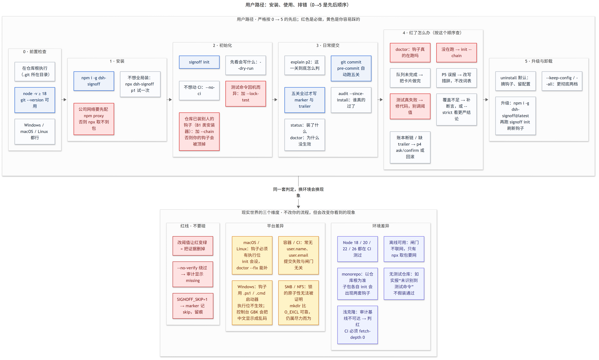
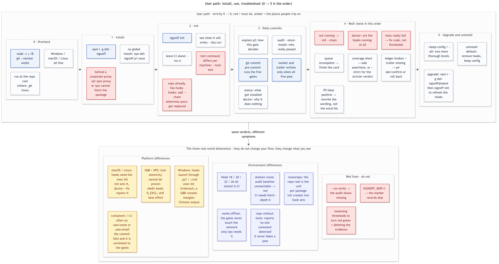

# 落印 / SignOff

> **包名 4.0.0 起为 `signoff-cli`**（曾用名 `dsh-signoff`，旧包已标记 deprecated）。
> 命令仍是 `signoff`；仓库地址仍是 `ayuanxx-max/signoff-cli`。DSH 只是它最早的使用场景，
> 任意 git 仓库、任意语言都可以直接用。

> 中文名「落印」：印落纸面才算数，对应英文名 SignOff。曾用名「一诺过五关」「执印」。命令是 `signoff`；
> 包名 4.0.0 起为 `signoff-cli`，仓库 4.1.0 起为 `ayuanxx-max/signoff-cli`（由 `dsh-signoff` 改名，老地址 301）。

> 签下的那句“做完了”，得自己走过五道关才算数。

五道关卡，五条命令，退出码即判决；发版另加第六道 `signoff release`（[见文末](#发布闸门signoff-release)）。每一关都对应 agent 交付时的一种失败方式：靠记忆跑测试、把“有开发页”当验证、多个 agent 撞同一文件、危险动作做过就忘、文档里塞空话。SignOff 把这五种失败变成五个可执行的检查。

```bash
npm i -g signoff-cli      # 或 npx signoff-cli
signoff p1                # 一关一关过
signoff all               # p1 + p2 + p5 + p4 verify
```

| 关 | 命令 | 判决什么 |
| --- | --- | --- |
| P1 验证 | `signoff p1` | 检查是否真的跑过、跑在预算内、用例数多少 |
| P2 覆盖 | `signoff p2` | 验证到了哪一级：scenario / harness / smoke / missing |
| P3 队列 | `signoff p3 validate\|plan\|collect` | 卡片是否齐、并发是否撞、谁越界谁没交 |
| P4 账本 | `signoff p4 ask\|confirm\|verify\|export` | 危险动作有没有票、回滚点是否还在 |
| 自查 | `signoff doctor [--json]` | 为什么没按预期生效：钩子、PATH、版本、安装点、账本、装钩子之后的缺失提交 |
| P5 反空话 | `signoff p5` | 文档里有没有空话、`绝对`化断言、无数字的`已验证` |

## 一张图看懂


六个层次从左到右：**入口**（CLI / git 钩子 / CI / Agent 面）都走同一个 `guard.js`；**调度**决定跑哪几关、
谁算通过；**五关**每关都写清“读什么、判什么、怎么修”；**状态机**说明一次提交里 marker 与 trailer 是怎么产生的；
**产物**是判断留下的证据；最右是**外部依赖**——只有 Node ≥18 与 git 是硬要求，其余都可缺。
判定没有“部分通过”：退出码 0 通过、1 任一关判红、2 用法或环境错。



上半部分按 0→5 的先后排：前置检查 → 安装 → 初始化 → 日常提交 → 红了怎么办 → 升级与卸载。
红框是必做，黄框是最容易踩的坑（`--chain`、`--lock-test`、npm proxy）。
下半部分三块是“不改你的流程、但会改变你看到的现象”：平台差异、环境差异，以及三条红线
（`--no-verify`、`SIGNOFF_SKIP=1`、调阈值让红变绿）。

两张图都由 Mermaid 生成，源文件在 [`docs/diagrams/src/`](docs/diagrams/src/)，改文案重渲一次即可，
不用重画。

## 零接触：装一次，之后不用管

目标是一条命令之后不再需要任何操作：`npm i -g signoff-cli` 装完即生效，之后每次 `git commit` 都自动受五关约束。

| 层 | 什么时候发生 | 覆盖范围 |
| --- | --- | --- |
| 机器层 | `npm i -g` 的 postinstall 写 `core.hooksPath` → `~/.signoff/hooks` | 本机**所有**仓库，新克隆的也算 |
| 仓库层 | postinstall（在某个仓库里执行时）或 `signoff ensure` | 该仓库的 `.git/hooks`、`.signoff/config.json`、CI workflow、ledger |
| 仓库声明 | 仓库根提交了 `signoff.json`（`signoff init --share` 生成） | 任何克隆：机器层见到声明就自动装全五关，克隆方零操作 |
| 关内 | 每次 commit | 已 opt-in 的仓库跑 P1–P5；未 opt-in 的仓库只跑 P1（测试必须过），不写任何状态 |

```bash
npm i -g signoff-cli      # 一次；postinstall 自动装好机器层 + 当前仓库
signoff ensure            # 换个仓库想把五关都装上，跑这一条（幂等）
signoff ensure --global   # 只重装/修复机器层
signoff ensure --json     # 给脚本看的结构化结果
```

npm 11 会把 `postinstall` 放进 allowlist 提示，可能不执行——所以还有一层兜底：**在该仓库里第一次跑任何一关**（比如 `signoff p5 README.md`）会自动把五关装好。
要放行安装脚本就加 `npm i -g signoff-cli --allow-scripts=signoff-cli`。

行为约定：

- 已 opt-in（有 `.signoff/config.json`）：pre-commit 跑全套五关，PASS 才写 marker 和 trailer。
- 未 opt-in：只跑 P1（有测试才跑，没测试就明说"没检测到测试运行器"后放行），不写 `.signoff` 配置、不带 trailer。
- 仓库自带的钩子不会被绕过：机器层先执行 `.git/hooks/<stage>`，它若是 signoff 的钩子就直接以它的判决为准。
- 提交 `signoff.json` 等于「这个仓库同意 P1–P5」：`.signoff/` 是 gitignore 的，声明文件进 git，
  所以别人克隆下来第一次 commit 就会把 hooks / config / CI 自己补上。字段见 `docs/signoff.schema.json`。
- 临时退出：`SIGNOFF_NO_BOOTSTRAP=1`（不做自动安装）、`SIGNOFF_NO_MACHINE=1`（不跑机器层的轻量关）。
- 撤销机器层：`signoff uninstall --global`。

## 一、案例：本次 DSH 2.0.22-next升级后在修复（dsh-session-fork-tree 0.9.34）bug里，五关各自做了什么？

这次修的是“升级 DSH 后，点侧栏「···」菜单，菜单闪一下就消失”。五关实际起了什么作用，逐条列出，包括没发挥作用的那一关。

| 关 | 本轮实际动作 | 证据 | 判定 |
| --- | --- | --- | --- |
| P1 | 手动跑 `precommit.ps1`；闸门第 10 层 pytest | `PASS 3666 ms`（101 用例）；第 10 层 `3438 ms` | 护栏有效；但它只跑工具自身的 Python 用例，**抓不到这次的前端问题**，也**没能自动拦提交**（插件目录是独立 git 仓库、没装钩子） |
| P2 | 三套真实 DOM 场景：`menu`(11) / `arrange`(13) / `perf`(6)；并把该包纳入覆盖率账本 | `coverage.py`：apps 4→5，scenario 5/5，断言 36→77 | **主力**。决定“修好没有”的是场景断言，不是肉眼；账本让这些断言不再是一次性证据 |
| P3 | 未使用：没写任务卡，没跑 `fanout.py` | 无 `card.json`、无 wave 记录 | **未发挥**。三件事有依赖顺序（修→测→说明引用实测数字），但这不等于可以不写卡留痕 |
| P4 | 事后审计抓到我自己填的假回滚点；补录发布记录 | `verify` 先 FAIL：`rollback point 'npm deprecate …' not a git ref`；修复后 `{"ok": true, "entries": 4, "problems": []}` | **事后有效，事前缺位**。`npm publish`、GitHub Release、改 profile 都是先做后记，没走取票 |
| P5 | 三份新文档过 slop 六规则；覆盖率表由工具重生成 | slop `{"ok": true, "files": 3, "hits": []}` | 有效；但把包登记进覆盖率是**发布之后**补的，说明里那组断言数当时还没进账本 |

一句话：**P2 决定“修好没有”，P5 决定“我有没有说大话”，P1 只证明没弄坏别处，P4 事后抓住了我自己的一笔脏账，P3 全程没上场。** 这个结论本身就是 SignOff 想要的输出：每一关都要能回答“发挥了没有”，不能只说“流程走过了”。

<h2 style="color:#c00000">你不需要做什么，照常进行任务，由它来守护这个过程；</h2>

## 二、自动守护：装一次，之后不用记

`signoff init` 把五关接进 git 与 CI，一次安装，之后正常 `git commit` / `git push` / 开 PR 都由它先查：

| 安装物 | 作用 |
| --- | --- |
| `.git/hooks/pre-commit` | 暂存区一变就跑闸门：文档改动 → P5；能探到测试命令 → P1；有 `verify/scenarios/` → P2 `--strict`；有账本 → P4 `verify`。红了直接拒绝提交 |
| `.git/hooks/pre-push` | push 前跑同一套（`--full`，不吃缓存） |
| `.git/hooks/commit-msg` | 把 `Signoff-Pass: <tree>`（跳过时 `Signoff-Skip:`）写进提交信息；`signoff audit` 与 CI 据此判断这次提交真的过过闸门 |
| `.github/workflows/signoff.yml` | 每个 push / PR 跑 `npx signoff-cli guard --ci`，绕不过去 |
| `.signoff/config.json` | 测试命令、预算、文档目录；`signoff status` 随时查看 |
| `.gitignore` | 追加 `.signoff/`，结果不进版本库 |

只依赖 **Node 18+**：闸门本身是 Node 实现（`lib/p*.js`），没有 Python 也能跑完整五关，不存在降级模式。

三条稳定性措施：**同一份暂存内容只判一次**（命中缓存约 0 ms，反复 `git commit --amend` 不重复付时间）；**失败只打印失败那一关的尾部**（完整日志在 `.signoff/hook.log`）；**超预算直接判红**（默认 180 秒，`--budget` 可改）。

**绕过的路仍然有，但不再无痕**：`signoff audit --range origin/main..HEAD` 逐个提交核对标记与提交树——缺失就是绕过（`git commit --no-verify`），判红；`SIGNOFF_SKIP=1` 的提交写成 `Signoff-Skip:` 并记进 `.signoff/skips.log`，`--strict` 下同样判红。生成的 CI 里已经带这一步。

**队友为什么也会被守住**：先把 `signoff-cli` 放进 `devDependencies`（`npm i -D signoff-cli`），再 `signoff init --prepare`，它会把 `signoff init --quiet` 并进 `package.json` 的 `prepare`，队友 `npm install` 完钩子就有了。没这个依赖时 `--prepare` 会拒绝写入并提示——否则 `npm install` 会因为找不到 CLI 直接失败。

```bash
signoff init                 # 装钩子 + CI + 配置
signoff init --chain         # 已有钩子保留：存为 <name>.local，先跑它
signoff init --prepare       # 同时写进 package.json，队友 npm install 即装钩子
signoff status               # 这个仓库现在守不守？
signoff doctor               # 为什么没按预期生效（只读）
signoff doctor --fix         # 让它把能证明的修掉：重装缺失钩子、补执行位、清掉没暂存的标记
signoff guard --full         # 手动跑同一套（钩子调的就是它）
signoff audit --range origin/main..HEAD   # 这些提交真过过闸门吗？
signoff audit --since-install             # 只看装钩子之后的提交（安装点不在 HEAD 祖先里会直接拒绝）
signoff init --reset-install              # 历史被改写或换了克隆后，把安装点挪到当前 HEAD
signoff init --lock-test                  # 把识别到的测试命令写进配置，换机器不再漂移
signoff uninstall --all      # 卸掉钩子 + CI + 配置
signoff uninstall --keep-config  # 卸掉钩子 + CI + 运行时状态，保留配置与账本
signoff p4 export --merge ../other/.signoff/audit.log   # 多仓库合并成一张表
signoff p4 export --format json --out ledger.json       # 也可以导出 json / csv
signoff explain p2           # 这一关到底查什么、怎么判的
signoff secrets              # 只扫暂存区的密钥泄露（钩子里自动先跑）
signoff secrets --all --json # 全仓库扫一遍，一条 JSON 判决
signoff report --html        # 一页只读看板：能不能发 + 月历 + 按任务

页面语言默认跟随系统：`signoff report --html --lang en` 出英文页，`--lang zh` 出中文页，不带就是 `auto`
（`SIGNOFF_LANG` → `LC_ALL`/`LANG` → 系统区域 → 中文）。DSH 侧栏面板按窗口语言自己切。
signoff report --days 90     # 只看最近 90 天
signoff report --since 2026-11-01 --until 2026-11-10
signoff report --task release      # 只看某个任务：任务卡 id、提交范围、sha 前缀或标题关键词
signoff report --gate p2 --json    # 只看一项，机器可读
signoff report --repos a,b         # 一页看几个仓库：先比谁挡住你，再逐个展开
signoff report --scan ~/code       # 找出目录两层内的所有 git 仓库，一起看
signoff report --would-block       # 只读预演：现在提交会被哪些离线关挡住
```

### 看现状：一页只读看板

`signoff report --html` 回答三个问题：**哪几项没过**、**某一天发生了什么**、**每个任务过了什么闸**。
默认写到 `.signoff/report.html`（该目录已在 gitignore 里），`--out` 指定别处，`--json` 给脚本。

页面不再是一张关表格（那对读的人没意义），而是几块：

| 块 | 内容 |
| --- | --- |
| 结论 | 一句话「几项未过 / 几项没跑过 / 全部通过」，下面只列**阻塞项**与它们的修复命令；已过的关压成一行 |
| 守卫体检 | 四张卡：最近一次全绿（距今多少提交）、安装点以来过闸率、绕过闸门数（含名单）、守卫在位（钩子 3/3 + CI） |
| 跑闸趋势 | 每项最近 30 次的结果条（绿=过 / 红=红）与通过率、最近耗时——来自 `.signoff/runs.log`，每次跑闸追加一行 |
| 月历 | 一个月历，有记录的日子带计数；点某天看那天的事件，默认**今天**；可翻月、可回今天 |
| 按任务 | 自动整理出全部任务组（P3 任务卡 ∪ 提交范围 `feat(report)` → `report`），每组带**过闸率**；默认收起、一次只展开一个，展开后能看到这一组的每次提交 |
| 危险动作打在哪 | 审计票据按目录聚类：哪个目录最常触发 allow / deny |
| 守卫状态 | 钩子 / CI / trailer / 机器层 / 测试命令 / 预算 / HEAD |

页面默认黑底（`color-scheme: dark`，正文 `#e9eaed`，过=绿 `#4ade80`、红=`#f87171`、待跑=黄 `#fbbf24`），
因为这类页面多半是「睡前扫一眼」或在编辑器旁边的深色终端里打开——白底会刺眼，也会把红绿压成一样的重要。

判据说清楚：**七项**=`测试 / 覆盖率 / 并发任务 / 危险动作 / 文档 / 密钥 / 发布`。发布项没有状态文件，它从
`package.json`、`server.json`、`CHANGELOG.md` 与 `git tag` 现算，并且会标明「tag 之后还有 N 个提交」。
「无标记」只对**安装点之后**的提交计数：带 `Signoff-Pass:` 是过闸，带 `Signoff-Skip:` 是显式跳过，
两者都没有就是 `--no-verify` 的形状。

页内脚本只做「切换视图」（点日期、翻月、展开任务），不发请求、不读写任何东西；页面里**没有**任何能通过、
跳过或放宽闸门的控件。查询全部靠参数：`--days / --since / --until / --task / --gate / --limit / --json`。

**多仓库**：`--repos a,b` 或 `--scan ~/code` 会把几个仓库放进同一页——先用一张表比「谁挡住你」
（结论、阻塞项数、过闸率、最近一次过闸时间），再逐个展开看那仓七项与阻塞项；三个以上仓库时这张表最省事。
「现在哪个仓库挡着我」比「某个仓库的上次结果」更接近他要的决定。

**预演**：`--would-block` 用当前工作树跑一遍能离线判定的关（密钥全仓扫、文档扫描、覆盖率只用上次缓存），
直接回答「现在提交会被挡吗」，并明确写出哪些项（测试 / 并发任务 / 发布）**必须真跑**才能判断。
它不执行测试、不写状态、不豁免任何关。

**给别人用：`--mount`**。页面默认躺在 `.signoff/`（gitignore），别人拿不到；`--mount [DIR]` 把它放到一个固定、
可发现的位置，默认 `~/.signoff/reports`：

```
~/.signoff/reports/
  index.html            所有已挂载仓库的索引页（结论 / 阻塞项 / 过闸率 / json 链接）
  index.json            同一份清单，机器读
  <仓库>-<路径指纹>/
    latest.html         这一仓的完整页面（单文件，拷走就能看）
    report.json         同一份数据
```

三类用法，都不需要额外配置：

| 谁 | 怎么用 | 依赖 |
| --- | --- | --- |
| 自己 | `signoff report --html --mount --open` | 本机浏览器（win `start` / mac `open` / linux `xdg-open`） |
| 同事 / 别的机器 | 拷走 `~/.signoff/reports/` 整个目录，或把它当 CI artifact 上传 | 一个浏览器，零依赖 |
| agent / 脚本 | `signoff report --json`，或 MCP 客户端调 `signoff_report`（`signoff mcp` 已在包里） | 不需要渲染页面 |

挂载只写自己的目录，不碰被检查的仓库；`--scan DIR --mount` 会把扫到的每个仓库各挂一份，索引页汇总。

**各平台各 agent 怎么接**：见 `docs/SURFACES.md`——核心只有 `report --json` 与 MCP 的 `signoff_report`，
DSH 侧栏面板、MCP 客户端、终端、CI、编辑器都只是把同一份数据渲染出来，判定不复制。

**契约与挂载**：报告页的行为写在 `docs/REPORT-CONTRACT.md`（C1…C10），这是唯一正文；
`AGENTS.md` / `CLAUDE.md` / `.github/copilot-instructions.md` / `.cursor/rules/signoff-report.mdc`
只是指过来的薄壳，供不同 agent 工具识别。没有仓库上下文时，`signoff report --contract` 会直接打印这份文件——
它随 npm 包一起分发，所以任何机器上装了 CLI 就能拿到同一份条款。改契约必须同时改自测断言，否则违约会变红。

| 层 | 位置 | 谁读 | 保证什么 |
| --- | --- | --- | --- |
| 正文 | `docs/REPORT-CONTRACT.md` | 人 / 任意 agent | 只此一份，条款编号 C1…C10 |
| 指针 | `AGENTS.md`、`CLAUDE.md`、`.github/`、`.cursor/rules/` | Codex / Claude Code / Copilot / Cursor / DSH | 各工具按自己的约定入口找到同一个地方，薄壳不复制条款 |
| 运行时 | `signoff report --contract` | 没有仓库的 agent、CI、离线机器 | 随包分发，字节与正文一致（自测比对） |
| 强制 | `test/selftest.js` | 预提交钩子 / CI | 违约 = 红色，不靠模型自觉 |
| 跨会话 | OpenViking `viking://resources/dsh/signoff-report-contract.md` | 别的机器、别的会话 | 检索得到，指向同一份正文 |

这一页**没有**任何能通过、跳过或放宽闸门的控件——那正是三条红线（`--no-verify`、`SIGNOFF_SKIP=1`、
调阈值让红变绿）最容易被悄悄破掉的地方。数据只来自 `.signoff/*.json` 与 `git`，跑它不执行任何关，
也不联网。

### 密钥扫描与提速（3.12.0 起）

- **P1 之前先扫密钥**：内置 16 条高信号规则（AWS / GitHub / GitLab / OpenAI / Google / Slack / Stripe / npm / SendGrid / 私钥块 / Azure / Discord webhook / 带密码的数据库 URL / 通用凭证）。
  命中即失败；装了 `gitleaks` 可用 `--engine gitleaks` 换全套规则，没装也不影响（纯 Node，无需二进制）。
- **值不会原样打印**：只显示 `AKIA…EF` 这种前缀 + 规则名 + 行号，避免把日志变成二次泄露。放行写在 `.signoff/config.json` 的 `secrets.allow`。
- **未 opt-in 的仓库也扫**：机器层守护走 `--no-state`，扫完不留任何文件。
- **运行器探测扩了 9 种**：go / cargo / maven / gradle / dotnet / ruby / elixir / php / make（`tests/` 与 `package.json` 仍在最前）。
- **同一暂存树结果缓存**：重复跑 0 ms；**纯文档提交跳过测试**。两个开关都可关：`SIGNOFF_NO_CACHE=1` / `SIGNOFF_NO_FAST=1`。

### 签名与增量覆盖率（3.13.0 起）

- **提交自带签名**：`signoff init --sign` 生成仓库本地 ed25519 密钥，`commit-msg` 在 `Signoff-Pass:` 之外再写
  `Signoff-Key:` + `Signoff-Sig:`（对完整 tree 签名，单行 base64）。没有密钥就只写未签名的 `Signoff-Pass`，不阻塞提交。
- **可以复核**：`signoff audit --verify` 逐个提交验签，`--require-signed` 把未签名也算失败。身份锚点是
  仓库里提交的 `.signoff/allowed_signers`（或 `signoff.json` 的 `allowed_signers`）：不在名单里只报 `self-signed`，绝不报 `verified`。
- **增量行覆盖率**：`signoff cov --diff --min 80` 只算这次改动新增的行，读项目已有的 `coverage/lcov.info` /
  `coverage-final.json` / python `coverage json`，不额外装运行器；没有覆盖率文件时报"没测过"，不会假装通过。
- **CI 直接标到行**：`GITHUB_ACTIONS=true` 时，密钥/覆盖率发现输出 `::error file=…,line=…` 注解并写步骤摘要，
  PR 页面直接看到，不用翻日志。

### 可核对的凭证（3.15.0 起）

`signoff p4 checkpoint` 给账本签一个检查点，`signoff p4 anchor` 打出一行可以贴到发版说明里的锚点：

```
signoff1:12:9f2c1ab34d0e:71b0c9d2e4a85f61
```

事后 `signoff p4 verify --checkpoint --anchor <那一行>` 能分辨四种情况：账本被截断、内容被改、
签名不属于受信 key、锚点与本机不一致。细节与边界（它不证明什么）见 [docs/trust.md](docs/trust.md)。

3.15.2 起还补了三件事：`signoff p4 path` 打印账本与检查点的真实位置（脚本不用猜）；
guard 通过后**自动续签**检查点（同一份账本不重复签，不产生无意义改动）；账本读取容忍 BOM
（Windows 编辑器与 `Set-Content -Encoding utf8` 的常见产物）。

### 能力矩阵与匿名竞品（3.15.2）

同一张表看"谁有什么"。竞品按类型匿名（不点名，避免把对比写成广告），对应关系与星标/下载数据
记录在 [`docs/signoff-positioning-3.15.2.md`](../docs/signoff-positioning-3.15.2.md)。

| 能力 | 落印 | 竞品A 平台级 | 竞品B 钩子框架 | 竞品C 密钥扫描 | 竞品D 文本规则 | 竞品E 供应链证明 | 竞品F 覆盖率 |
| --- | --- | --- | --- | --- | --- | --- | --- |
| 测试真的跑过（预算 + 用例数） | 有 | 有 | 无（只负责触发） | 无 | 无 | 无 | 无 |
| 增量覆盖率分级 | 有 | 有 | 无 | 无 | 无 | 无 | 有 |
| 密钥扫描 | 有 | 有 | 无 | 有 | 无 | 无 | 无 |
| 中文文档空话规则 | 有 | 无 | 无 | 无 | 部分（英文词表） | 无 | 无 |
| 可验签的判决（trailer + key） | 有 | 部分（服务端签名） | 无 | 无 | 无 | 有（attestation） | 无 |
| 离线账本 + 截断检测 | 有 | 无 | 无 | 无 | 无 | 部分（需 layout/验证器） | 无 |
| 可发布锚点（一行贴进发版说明） | 有 | 无 | 无 | 无 | 无 | 无 | 无 |
| 零配置两步上手 | 有 | 无（要服务端 + 项目配置） | 部分（需已有 Node/Python 项目） | 有 | 有 | 无（要密钥与 layout） | 有 |
| 托管看板 / PR 状态回写 | 无 | 有 | 无 | 无 | 无 | 无 | 无 |

结论放在表后面而不是前面：**前七行是它和其他工具的分野，最后两行是它的短板**——托管面没有，
生态采用量也还没起来（1 star、周下载三位数），所以六维里"生态"给 3 分，不是 5 分。


上图是一次提交的完整路径：入口（git commit / 命令 / CI）→ 三层零接触 → guard 固定顺序跑
secrets → p5 → p1 → p2 → p4 → cov（opt-in）→ 判决 → 四层证据（marker → trailer → 账本 →
检查点 → 锚点）。红一关即停，退出码就是判决。


上图横轴是生态采用度，纵轴是覆盖广度。落印落在左上角——**功能全、采用低**，这是它的真实位置：
它不在右上角跟平台级产品比采用，差异在"判决可以带走、可以事后核对"。

### 规则包、预设与编辑器（3.14.0 起）

- **P5 规则包**：`--pack zh|en|both`。中文词表是默认值，行为不变；`en` 用词边界匹配
  （`very` 不会命中 `delivery`），`both` 两套一起跑并按行去重。`--rules rules.json` 追加自定义词表
  （`ai_words` / `absolute` / `adverbs` / `claims` / `placeholder`），也可写进 `.signoff/config.json`
  的 `p5` 或 `signoff.json` 的 `p5`。
- **场景预设**：`signoff init --preset node|python|go|java`，一次给出预算、文档目录、覆盖率阈值和规则包；
  `test_cmd` 仍交给自动探测，克隆到没有该脚本的机器也不会锁死。
- **VS Code**：`signoff init --editor vscode` 写 `.vscode/tasks.json`（guard / all / secrets / cov / audit / status）
  与 problem matcher，失败直接落到 Problems 面板；已存在的任务只合并不覆盖。

## 三、在其它代码过程里能干什么

| 场景 | 五关怎么用 |
| --- | --- |
| 新功能 | P3 先写卡（目标 / scope / 验收 / 回滚）→ P1 让检查命令化并进钩子 → P2 把验收写成场景断言 → P4 发版取票 → P5 文档只留能被数字支撑的句子 |
| 修 bug | P1 把复现命令固化（`--run` 可重复）→ P2 加一条“反向断言”（旧写法必须红）→ P3 多人并行时按 scope 分波 → P4 单点回滚 → P5 说明里每个数字能落到事实表 |
| 重构 | P3 的 scope 锁死可动范围，`collect` 抓越界改动；P2 用零写入 / DOM 恒等这类断言证明“行为没变” |
| CI 流水线 | `signoff all` 一条命令，退出码直接当 CI 判决；P1 的预算参数防止测试变慢却没人发现 |
| 多 agent 并行 | P3 `plan` 输出 wave（scope 相交的卡绝不同波），`collect` 抓“改了不该改的文件”和“交了空活”的卡 |
| 交接与复盘 | P2 的覆盖表 + P4 `export` 出的账本，接手的人先看这两张表，再看代码 |
| 合规留痕 | P4 哈希链：改过的记录会被 `verify` 判为 `content hash mismatch`，事后补账能被发现 |

## 四、在 DSH 任务里能干什么

- **发 npm / 改 profile / 改 cordis 配置**：P4 先 `ask` 取票（单次、10 分钟过期、绑定动作类别），再 `confirm` 落账，账里带回滚点；回滚点必须是真的 git ref，写一句“npm deprecate …”会被 `verify` 拒绝。
- **插件发版**：P1 跑三套真实 DOM fixture，P2 把结果记进覆盖率表，P5 保证发布说明里没有`绝对`化的收尾句。
- **长任务 / 跨天任务**：P3 的卡片就是断点续传的凭据——scope、验收、回滚点三样齐了，换会话也能接上。
- **多分叉并行**：不同分叉各拿一张卡，`plan` 先算出不会撞文件的波次，避免两个 agent 同时改同一处。
- **收尾**：P5 的六条规则让“完成”这句话可以被机器反驳：无数字的`已验证`、`TODO`、`绝对`化断言、AI 味词表（`赋能` / `闭环` / `抓手`…），命中即失败。
- **插件回归**：`verify/scenarios/*.json` 是 P2 的输入格式，把 fixture 的 checks 数量直接变成覆盖率数字，不需要另写报表。

## 看板：一个核心，多个薄壳

判定只在 `lib/` 里算一次，看板只负责画。三个能「看」的落点：

| 落点 | 怎么开 | 数据从哪来 |
| --- | --- | --- |
| 单文件页面 | `signoff report --html --mount`，再打开 `~/.signoff/reports/index.html` | 该目录里的 `index.json` 与每仓 `report.json` |
| DSH 侧栏面板 | 侧栏导航第 4 行「SignOff 看板」（`integrations/dsh-panel/`） | 同一个挂载目录，只读 |
| MCP | `signoff mcp` 的 `signoff_report` 工具 | 同一条命令行的输出 |

`--mount` 只写自己的目录（默认 `~/.signoff/reports`，也可 `--mount DIR`），不碰被检查的仓库；
索引里的链接都是相对路径，整个目录拷到别的机器照样能开；`--open` 用系统默认浏览器打开索引页。

DSH 面板装法：

1. profile 的 `package.json` 里加 `"@local/signoff-board": "link:<仓库>/integrations/dsh-panel"`；
2. 在 `node_modules/@local/signoff-board` 建目录联接指向同一目录（Windows: `mklink /J`）；
3. `cordis.patch.yml` 末尾加 `- insert: [{ id: signoff-board, name: '@local/signoff-board' }]`。

面板只读：没有跑闸 / 跳过 / 改阈值的控件，唯一会写东西的按钮是把那张页面交给系统浏览器打开。
为什么路由不能挂在 `/api` 下面、以及热重载时的重复路由，见 `integrations/dsh-panel/README.md`；
各平台与各 agent 怎么接，见 `docs/SURFACES.md`（英文：`docs/SURFACES.en.md`）。

## 五、命令速查

```bash
# 自动守护：装一次，之后不用记
signoff init
signoff status
signoff guard --full
signoff uninstall --all

# P1：跑检查；默认 tests/ 用 pytest，否则 npm test
signoff p1 --run "pytest -q" --run "npm run lint" --budget 120
signoff p1 --install-hook            # 写入 .git/hooks/pre-commit

# P2：覆盖分级 + 阈值
signoff p2 --strict --min-scenario 4 --min-assertions 60 --md docs/coverage.md

# P3：卡片校验 / 波次规划 / 收集核对
signoff p3 validate --cards tasks
signoff p3 plan --cards tasks
signoff p3 collect --changed src/a.py src/b.py

# P4：取票 → 消费 → 校验 → 导出
signoff p4 ask --action publish --target "demo@1.2.0"
signoff p4 confirm --ticket 1a2b3c4d --decision allow --detail "npm publish" --rollback v1.2.0
signoff p4 verify
signoff p4 export --out docs/ledger.md

# P5：反空话
signoff p5 docs README.md
```

每关都会把结果写到 `.signoff/pN.json`（P4 的账本在仓库内 `.signoff/audit.log`，不在仓库里时退回 `~/.signoff/audit.log`；可用 `SIGNOFF_HOME` 改位置），便于 CI 存档与二次核对。

## 接入方式

- **CLI**（本体）：`npm i -g signoff-cli`，任何能起进程的地方都能调，退出码即判决。
- **技能**：`integrations/skill/SKILL.md`，把“退出码是判决、不许绕过、先 doctor 再 explain”教给 agent。
- **MCP 服务器**：`npx -y signoff-cli mcp`（或 `integrations/mcp/server.js`），给 Claude Desktop / DSH / IDE 用，五个工具，`isError` 跟随退出码；官方 MCP Registry 条目为 `io.github.ayuanxx-max/signoff`。
- **宿主插件**：可行但不推荐（只有要画 UI 时才值得），理由见 [docs/integrations.md](docs/integrations.md)。

推广与可发现性的现状和做法见 [docs/promotion.md](docs/promotion.md)。

## 发布闸门（signoff release）

`p1..p5` 检查的是工作树，`signoff release` 检查的是**发布物**——这一段过去没有任何闸门覆盖，于是
注册表清单能把 `packages[].version` 钉在 3.9.4 上继续发布 40 个版本没有被发现。

```powershell
signoff release --pre    # 发布前：清单自洽 + 打包 + 装到临时目录 + --version + mcp 握手（14 项）
signoff release --post   # 发布后：npm latest、注册表 isLatest / packages[].version、README 图链
```

它第一次运行就抓到一个真缺陷：`files[]` 漏了 `integrations/`，导致 3.9.3 起所有安装形态的
`signoff mcp` 都是 `MODULE_NOT_FOUND`，而注册表恰好教人用 `npx signoff-cli mcp`。现在 `integrations/`
已进包，`--pre` 为 14/14。

## 六、边界（先说清不做什么）

- **只读不改**：五关不改你的代码，只在 `.signoff/`（P4 账本也在这里；非仓库目录才用 `~/.signoff/`）写结果。
- **P1 只看退出码**：不做交互、不猜意图；命令怎么写由你给。
- **P2 不生成断言**：断言要人写；它只负责数、分级、拦住“没到 scenario 级”的降级。
- **P4 是本机哈希链**，不是外部公证：能发现事后改账，不能防有人连链一起重写。要更强证据得接外部时间戳。
- **P5 是启发式**：词表可以按团队改（`--allow <rule>` 放行某条），它拦住的是“明显没数字的断言”，不是全部坏文档。
- **钩子按仓库各装一次**：`signoff init` 写在本机 `.git/hooks/`，别人 clone 不会自动有；CI 那条才是全员生效。
- **测试命令是“查出来的”，不是“猜出来的”**：按 `package.json` 的 `test` 脚本 → vitest/jest/mocha 依赖 → `Cargo.toml` → `go.mod` → `Makefile` 的 `test` → pytest → unittest 的顺序识别；`signoff init` / `status` / `doctor` 都会写出用的是哪一条、从哪认出来的。`tests/` 是空目录不算测试，不会让 p1 空跑一场报“没收集到用例”。
- **原有钩子不会被悄悄顶掉**：`signoff init` 默认把现有钩子备份成 `<name>.signoff-backup`（不串接）；加 `--chain` 则存成 `<name>.local`（Python/Node/PowerShell 钩子保留 `.py`/`.js`/`.ps1` 后缀，按后缀选解释器）并在我们的钩子里先执行——它失败就停，`signoff uninstall` 会把它原样装回 `<name>`。
- **账本可以跨仓库合并**：`signoff p4 export --merge <另一个仓库的 audit.log>` 会逐文件重算哈希链，链断了的那份会被标出来并以 1 退出——合并视图不会替坏链背书。
- **同一仓库同时只跑一次钩子**：`.signoff/lock` 是单实例锁（3.9.1 起是目录 + `owner.json`，用 `mkdir` 抢锁——`O_EXCL` 在 SMB/NFS 上可能两边都成功），第二个提交会拿到“谁在占用”并退 1；锁的持有进程已死或超过 10 分钟自动作废。`commit-msg` 不参与加锁——它不能把已经接受的提交再挡回去。
- **`doctor` 只读**：它从不安装、不改写、不删除，只把 `status` / `audit` / `p4 verify` 的结论摊开并给出修法；`ok` 判 0，有 `fail` 判 1，不在仓库里判 2。
- **安装点对不上就拒绝，不给出偏大的范围**：`audit --since-install` 先确认安装点是 HEAD 的祖先（`merge-base --is-ancestor`），rebase、强推、换克隆之后那条提交不在当前历史里，会退 2 并让你跑 `signoff init --reset-install`——审计结论不可信比审计报错更糟。
- **装钩子之前的历史不算账**：`signoff init` 把当时的提交记进 `.signoff/installed.json`，`signoff audit --since-install` 从那里起算；普通 `audit` 遇到装钩子之前的缺失提交，会多打一行 `N of M missing commit(s) predate the install point`，不用自己算范围。
- **钩子可绕过，但会留下证据**：`git commit --no-verify` 不触发钩子，提交里就没有 `Signoff-Pass` 标记，`signoff audit`（CI 自动跑）判红；`SIGNOFF_SKIP=1` 写 `Signoff-Skip` 并记进 `.signoff/skips.log`，`--strict` 下判红。
- **只需要 Node 18+**：闸门与钩子都是 Node；没有 Python、没有其它解释器也能跑完整五关。
- **不联网**：除 `git` 与本地解释器外不调用外部服务。

## English

**Language.** The board follows your system language by default: `signoff report --html --lang en` renders the
English page, `--lang zh` the Chinese one, and omitting it means `auto` (`SIGNOFF_LANG` → `LC_ALL`/`LANG` → system
locale → Chinese). The DSH panel switches on its own, using the window language.

### Package name (since 4.0.0)

The package is `signoff-cli`; the former name `dsh-signoff` is deprecated. The command stays
`signoff`; the repository is `ayuanxx-max/signoff-cli` since 4.1.0 (renamed from `dsh-signoff`,
old URLs 301). Nothing about the tool is DSH-specific — any git repo and any language work.

### At a glance (English)


Six layers, left to right: **entry** (CLI / git hooks / CI / agents) all go through one `guard.js`; **dispatcher**
decides which gates run and what counts as pass; **the five gates** (plus `release`, which guards what you publish) each state read → decide → fix; **the state
machine** shows how the marker and the trailer appear inside a single commit; **artifacts** are the evidence a
verdict leaves behind; **external dependencies** — only Node ≥18 and git are hard requirements.
There is no partial pass: exit 0 pass, 1 any gate red, 2 usage or environment error.



Stages 0 → 5 in order: precheck → install → init → daily commits → when it goes red → upgrade and uninstall.
Red boxes are must-do; amber boxes are the places people trip on (`--chain` when the repo already has husky
hooks, `--lock-test` when the test command differs per machine, a corporate npm proxy).
The lower half covers the three dimensions that change what you see without changing the flow: platform
differences, environment differences, and three red lines (`--no-verify`, `SIGNOFF_SKIP=1`, loosening
thresholds to turn red green).


> "Done" is a promise. SignOff makes it walk through five gates before anyone signs it.

Five gates, five commands, the exit code is the verdict; publishing adds a sixth, `signoff release`. Each gate maps to one way agent work goes wrong: tests run from memory, a dev page mistaken for verification, parallel workers colliding on the same file, risky actions nobody recorded, documents padded with empty words.

| Gate | Command | What it decides |
| --- | --- | --- |
| P1 verify | `signoff p1` | Did the checks actually run, inside the budget, with how many cases |
| P2 coverage | `signoff p2` | What level the verification reached: scenario / harness / smoke / missing |
| P3 queue | `signoff p3 validate\|plan\|collect` | Cards complete, waves collision-free, nobody out of scope or empty-handed |
| P4 ledger | `signoff p4 ask\|confirm\|verify\|export` | Did the risky action hold a ticket, is the rollback point still there |
| P5 anti-slop | `signoff p5` | Empty words, absolute claims, "verified" with no number |

### Secrets and speed (since 3.12.0)

- `signoff secrets` scans the index before P1 runs; the guard calls it first, always.
  Sixteen high-signal rules (AWS, GitHub, GitLab, OpenAI, Google, Slack, Stripe, npm,
  SendGrid, private-key blocks, Azure, Discord webhooks, credentialed DB URLs, generic
  `password = "..."`), plain Node, no binary. `--engine gitleaks` uses gitleaks when installed.
- Values are masked in output (`AKIA…EF`); allow a rule in `.signoff/config.json` under `secrets.allow`.
- The machine-wide guard scans secrets even in repos that never opted in (`--no-state`: nothing written).
- Runner detection now covers go / cargo / maven / gradle / dotnet / ruby / elixir / php / make.
- Same staged tree = cached verdict (0 ms); a docs-only commit skips the suite. Off switches:
  `SIGNOFF_NO_CACHE=1`, `SIGNOFF_NO_FAST=1`.

### Signed verdicts and change coverage (since 3.13.0)

- `signoff init --sign` creates a repo-local ed25519 key; `commit-msg` then adds `Signoff-Key:` +
  `Signoff-Sig:` next to `Signoff-Pass:`. The signature covers the full tree id and is a single
  base64 line, so it survives as a trailer. No key means an unsigned trailer - never a blocked commit.
- `signoff audit --verify` checks each commit's signature; `--require-signed` makes unsigned commits
  fail. Identity needs an anchor: a committed `.signoff/allowed_signers` (or `allowed_signers` in
  `signoff.json`). A key that is not listed is reported `self-signed`, never `verified`.
- `signoff cov --diff --min 80` counts only lines this change adds, reading the coverage file the
  project already writes (lcov, istanbul, python coverage json). No coverage file means "not
  measured", not "passed".
- Under `GITHUB_ACTIONS=true`, findings become `::error file=...,line=...` annotations plus a step
  summary, so a reviewer sees them on the diff.

### Checkpointed evidence (since 3.15.0)

`signoff p4 checkpoint` signs the ledger head and Merkle root; `signoff p4 anchor`
prints one line to publish with the release. `signoff p4 verify --checkpoint --anchor`
then tells truncation, edits, untrusted keys and anchor drift apart. Scope and limits:
[docs/trust.md](docs/trust.md).

Since 3.15.2: `signoff p4 path` prints where the ledger and checkpoint actually live (no guessing in
scripts); a passing guard re-signs the checkpoint (same ledger, same statement, no churn); ledger
reads tolerate a UTF-8 BOM, which Windows editors and `Set-Content -Encoding utf8` leave behind.

### Capabilities and anonymised peers (3.15.2)

One table for "who has what". Peers are anonymised by category so the comparison reads as a table,
not an advert; the mapping plus star/download figures live in
[`docs/signoff-positioning-3.15.2.md`](../docs/signoff-positioning-3.15.2.md).

| Capability | SignOff | Peer A platform | Peer B hooks | Peer C secret scan | Peer D text rules | Peer E supply chain | Peer F coverage |
| --- | --- | --- | --- | --- | --- | --- | --- |
| Tests actually ran (budget + case count) | yes | yes | no (triggers only) | no | no | no | no |
| Changed-line coverage levels | yes | yes | no | no | no | no | yes |
| Secret scanning | yes | yes | no | yes | no | no | no |
| Chinese prose rules | yes | no | no | no | partial (English only) | no | no |
| Signed verdict (trailer + key) | yes | partial (server side) | no | no | no | yes (attestation) | no |
| Offline ledger + truncation detection | yes | no | no | no | no | partial (needs layout/verifier) | no |
| Publishable anchor (one line in release notes) | yes | no | no | no | no | no | no |
| Two-command, zero-config start | yes | no (server + project config) | partial (needs a Node/Python project) | yes | yes | no (keys + layout) | yes |
| Hosted dashboard / PR status | no | yes | no | no | no | no | no |

Read the last two rows as the honest part: **no hosted surface, and adoption is still small**
(1 star, three-digit weekly downloads) — which is why "ecosystem" scores 3, not 5.


One commit end to end: entries (git commit / CLI / CI) → three zero-touch layers → guard runs
secrets → p5 → p1 → p2 → p4 → cov (opt-in) → verdict → four layers of evidence (marker → trailer →
ledger → checkpoint → anchor). First red stops; the exit code is the verdict.


Adoption on the x-axis, coverage breadth on the y. SignOff sits top-left: **full-stack, low adoption**.
It does not compete on adoption with platform products; the difference is that a verdict can leave
the machine and still be checked later.

### Rule packs, presets and editors (since 3.14.0)

- `--pack zh|en|both` for gate 5. Chinese stays the default so existing output is unchanged;
  `en` matches on word boundaries (`very` does not fire on `delivery`); `both` runs the two packs
  and de-duplicates per line. `--rules rules.json` adds your own `ai_words` / `absolute` /
  `adverbs` / `claims` / `placeholder`, and the same object can live in `signoff.json` (`p5`).
- `signoff init --preset node|python|go|java` sets budget, docs, coverage threshold and rule pack.
  `test_cmd` stays auto-detected so a machine without that script still runs something.
- `signoff init --editor vscode` writes `.vscode/tasks.json` (guard / all / secrets / cov / audit /
  status) plus problem matchers, so a failure lands in the Problems panel. Existing tasks are
  merged, never replaced.

### Zero-touch

One command, then nothing: `npm i -g signoff-cli` writes a machine-wide `core.hooksPath`
(`~/.signoff/hooks`) and bootstraps the repo it is installed from.

| Layer | When | Scope |
| --- | --- | --- |
| machine | postinstall of the global install | every repo on this machine, including fresh clones |
| repo | postinstall inside a repo, or `signoff ensure` | `.git/hooks`, `.signoff/config.json`, CI workflow, ledger |
| declaration | a committed `signoff.json` (`signoff init --share`) | every clone: the machine layer sees it and builds all five gates, no local step |
| gates | every commit | opted-in repos run all five; unopted repos run only P1 (tests), and write no state |

npm 11 may hold `postinstall` behind its script allowlist (`--allow-scripts=signoff-cli` to allow it), so the
first gate command in a repo (`signoff p5 README.md`) installs the five gates as a fallback.

Committing `signoff.json` is the repository agreeing to P1-P5: `.signoff/` is gitignored, the declaration is not,
so a clone builds the rest on its first commit. Fields: `docs/signoff.schema.json`.

Exit hatches: `SIGNOFF_NO_BOOTSTRAP=1` (no auto install), `SIGNOFF_NO_MACHINE=1` (skip the light guard),
`signoff uninstall --global` (remove the machine layer). A repo's own hook always runs first and keeps its verdict.

### Case: what the five gates did in the 0.9.34 bug fix after the DSH 2.0.22-next upgrade

| Gate | Action in this fix | Evidence | Verdict |
| --- | --- | --- | --- |
| P1 | Ran `precommit.ps1` by hand; gate layer 10 ran pytest | `PASS 3666 ms` (101 cases); layer 10 `3438 ms` | Guard worked, but it only covers the tooling's own Python tests: it could not see the front-end bug, and it did not gate the commit automatically (the plugin directory is its own git repo without the hook) |
| P2 | Three real-DOM scenarios: `menu`(11) / `arrange`(13) / `perf`(6), and registered the package in the coverage ledger | `coverage.py`: apps 4→5, scenario 5/5, assertions 36→77 | **The main work.** Scenario assertions decided "fixed or not"; the ledger keeps them from being one-off evidence |
| P3 | Not used: no task cards, no wave plan | no `card.json`, no wave record | **Did not contribute.** The three asks were sequential, which is not a reason to skip the paper trail |
| P4 | Post-hoc audit caught a fake rollback point I wrote; the publish was then recorded properly | `verify` first failed with `rollback point 'npm deprecate …' is not a git ref`; after repair `{"ok": true, "entries": 4, "problems": []}` | **Effective after the fact, absent before it**: publish, release and profile edits ran before any ticket |
| P5 | Three new documents through the six slop rules; coverage table regenerated by the tool | slop `{"ok": true, "files": 3, "hits": []}` | Worked, but registering the package in coverage happened after the release, so the assertion counts in the notes were not in the ledger yet |

One line: **P2 decides whether it is fixed, P5 decides whether I am overclaiming, P1 only proves nothing else broke, P4 caught my own dirty entry after the fact, P3 never left the bench.**

<h2 style="color:#c00000">You do not have to do anything differently — just carry on with your task, and it guards the process.</h2>

### Auto-guard: install once, then it runs itself

`signoff init` wires the gates into git and CI, so an ordinary `git commit`, `git push` or pull request is checked first:

| Installed | What it does |
| --- | --- |
| `.git/hooks/pre-commit` | On a change to the index: docs → P5; detectable test command → P1; `verify/scenarios/` → P2 `--strict`; existing ledger → P4 `verify`. A red gate refuses the commit |
| `.git/hooks/pre-push` | The same set before a push, `--full`, no cache |
| `.git/hooks/commit-msg` | Writes `Signoff-Pass: <tree>` (or `Signoff-Skip:`) into the message; `signoff audit` and CI use it to tell a gated commit from a bypass |
| `.github/workflows/signoff.yml` | Every push / PR runs `npx signoff-cli guard --ci`; not bypassable |
| `.signoff/config.json` | Test command, budget, doc roots; `signoff status` shows all of it |
| `.gitignore` | `.signoff/` is appended, so results stay out of the repo |

Requires **Node 18+ only**: the gates are pure Node (`lib/p*.js`), so no Python is needed and there is no degraded mode.

Three stability measures: the same staged tree is judged once (cache hit ~0 ms, so `git commit --amend` costs nothing); a failure prints only the tail of the failing gate (full log in `.signoff/hook.log`); exceeding the budget (default 180 s) is a red gate, not a silent twenty-minute hook.

**A bypass leaves a trace**: `signoff audit --range origin/main..HEAD` checks every commit's marker against its tree. Missing means the gates were skipped (`git commit --no-verify`) and is red; a `SIGNOFF_SKIP=1` commit carries `Signoff-Skip` and turns red under `--strict`. The generated CI already runs this step.

**Why a teammate ends up guarded too**: with `signoff-cli` in `devDependencies` (`npm i -D signoff-cli`), `signoff init --prepare` appends `signoff init --quiet` to `package.json`'s `prepare`, so their `npm install` installs the hooks; without it, CI is the backstop.

### Beyond this fix: other code work

- **New feature**: card first (P3: goal / scope / acceptance / rollback), then a failing check wired into the hook (P1), then scenario assertions (P2), then a publish ticket (P4), then prose that every number supports (P5).
- **Bug fix**: freeze the reproduction as a command (P1 `--run`), add a reverse assertion that must go red on the old code (P2), split parallel work into waves (P3), keep one rollback point (P4), and publish only numbers (P5).
- **Refactor**: scope bounds what may change and `collect` flags out-of-scope edits (P3); zero-write and DOM-identity assertions prove behaviour did not move (P2).
- **CI**: `signoff all` is one command whose exit code is the verdict; `--budget` catches a suite that quietly got slower.
- **Multi-agent**: `plan` emits waves where overlapping scopes never share a wave; `collect` reports both "changed a file nobody owns" and "card shipped nothing".
- **Handover**: the coverage table (P2) plus the exported ledger (P4) are the first two things a new owner should read.

### In DSH tasks

- **npm publish, profile edits, cordis config changes**: P4 `ask` mints a single-use ticket (10 minute TTL, bound to the action category); `confirm` appends a hash-chained entry with a rollback point that must be a real git ref.
- **Plugin releases**: P1 runs the real-DOM fixtures, P2 records them in the coverage ledger, P5 keeps the release notes free of absolute claims.
- **Long or multi-day tasks**: a card with scope, acceptance and rollback is the resume token - a new session can pick it up.
- **Parallel forks**: each fork takes a card; `plan` computes waves that cannot collide.
- **Closing**: P5's six rules make "done" falsifiable by a machine: a numberless "verified", a `TODO`, an absolute claim, or a banned buzzword fail the run.
- **Plugin regression**: `verify/scenarios/*.json` is P2's input, so fixture check counts become coverage numbers with no extra reporting.

### Usage

```bash
# auto-guard: install once
signoff init
signoff status
signoff guard --full
signoff uninstall --all

signoff p1 --run "pytest -q" --budget 120
signoff p1 --install-hook
signoff p2 --strict --min-scenario 4 --min-assertions 60 --md docs/coverage.md
signoff p3 validate --cards tasks
signoff p3 plan --cards tasks
signoff p3 collect --changed src/a.py
signoff p4 ask --action publish --target "demo@1.2.0"
signoff p4 confirm --ticket 1a2b3c4d --decision allow --rollback v1.2.0
signoff p4 verify
signoff p5 docs README.md
```

### Boundaries

- Read-only with respect to your code: results go to `.signoff/` (the P4 ledger included; `~/.signoff/` only outside a repo).
- P1 judges exit codes only.
- P2 counts and grades; it does not write assertions for you.
- P4 is a local hash chain, not external notarisation: it detects edits after the fact, and cannot stop someone rewriting the whole chain.
- P5 is heuristic; tune the word list with `--allow <rule>`.
- Hooks are installed per clone; a fresh clone needs `signoff init` again, while CI covers everyone.
- Hooks are bypassable, but not silently: `git commit --no-verify` leaves no `Signoff-Pass` marker, so `signoff audit` (run by CI) fails the range; `SIGNOFF_SKIP=1` leaves `Signoff-Skip` and is red under `--strict`.
- Needs Node 18+ only; no Python and no other interpreter is required.
- No network calls; only `git` and the local interpreters.

### Integrations

- **CLI** (the product): `npm i -g signoff-cli`; anything that can spawn a process can run
  it, and the exit code is the verdict.
- **Skill**: `integrations/skill/SKILL.md` teaches an agent the three things it gets wrong:
  the exit code is the verdict, never bypass a red gate, and `doctor`/`explain` come before
  touching config.
- **MCP server**: `integrations/mcp/server.js` for Claude Desktop / DSH / IDEs — five tools,
  `isError` mirrors the exit code.
- **Host plugin**: possible but not recommended; it only pays off when gate results must be
  rendered in a host UI. Reasoning in [docs/integrations.md](docs/integrations.md).

Discovery and promotion notes: [docs/promotion.md](docs/promotion.md).

### Release gate (English)

`p1..p5` read the working tree; `signoff release` reads the published artifact. `--pre` runs offline
(manifest consistency, `npm pack`, install into a temp dir, `--version`, an `mcp` initialize handshake -
14 checks); `--post` runs after publish and verifies npm `dist-tags.latest`, the MCP registry entry, and
every README image URL. Its first run found that `files[]` omitted `integrations/`, so every installed
copy since 3.9.3 had a `signoff mcp` that failed with `MODULE_NOT_FOUND`.

### Boards: one core, several thin shells

The verdict is computed once, in `lib/`; every board only draws it. Three places to look:

| Surface | How to open it | Where the data comes from |
| --- | --- | --- |
| Single-file page | `signoff report --html --mount`, then open `~/.signoff/reports/index.html` | `index.json` plus each repository's `report.json` in that directory |
| DSH sidebar panel | the fourth row of the sidebar navigation, "SignOff 看板" (`integrations/dsh-panel/`) | the same mount directory, read-only |
| MCP | the `signoff_report` tool from `signoff mcp` | the same command line output |

`--mount` writes only its own directory (default `~/.signoff/reports`, or `--mount DIR`), never the repository
under test. Links in the index are relative, so the directory survives being copied to another machine, and
`--open` hands the index page to the system browser.

Installing the DSH panel takes three steps:

1. add `"@local/signoff-board": "link:<repo>/integrations/dsh-panel"` to the profile's `package.json`;
2. create a directory junction at `node_modules/@local/signoff-board` pointing at the same directory
   (Windows: `mklink /J`);
3. append `- insert: [{ id: signoff-board, name: '@local/signoff-board' }]` to `cordis.patch.yml`.

The panel is read-only: no control runs a gate, skips one, or relaxes a threshold; the only button that changes
anything hands the page to the system browser. Why the route cannot live under `/api`, and what a hot reload does
to a duplicate route, are in `integrations/dsh-panel/README.md`. The surface matrix for other platforms and agents
is in `docs/SURFACES.md` (English: `docs/SURFACES.en.md`).

## License

MIT
