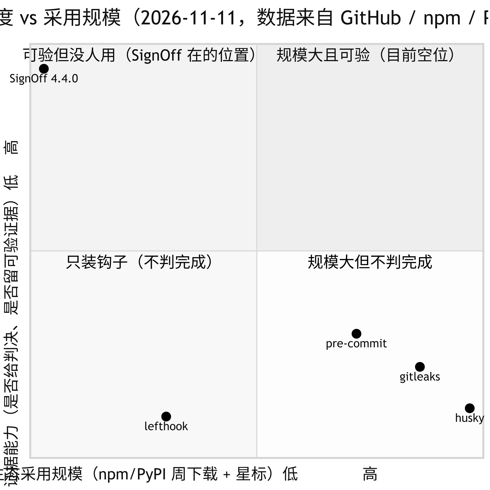
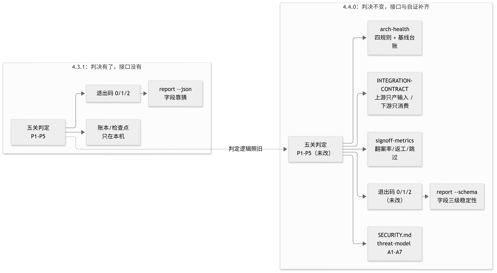

# How SignOff compares: position, numbers, quadrant

> Data pulled 2026-11-11 from the GitHub REST API, the npm registry API and pypistats.
> Every number is reproducible; the per-dimension scores are my judgement, with the reasoning in each row.

## 1. Position first

SignOff is not a linter, not a formatter, not a code reviewer. It answers one question:
**did this commit actually pass — and if it did, on what evidence?**

So the real peers are not "find bugs for you" tools. They are the layer that decides whether a commit
may enter: husky, pre-commit, lefthook. All four compete for the same file: `.git/hooks/pre-commit`.

## 2. Real size

| Project | Form | Stars | Forks | Open issues | Last push | Weekly downloads |
| --- | --- | --- | --- | --- | --- | --- |
| husky | Node hook installer | 35,388 | 1,103 | 109 | 2026-03-19 | **49,271,405** (npm) |
| pre-commit | Python hook framework | 15,691 | 1,020 | 25 | 2026-11-09 | **35,897,535** (PyPI) |
| lefthook | Go hook runner | 9,019 | 336 | 115 | 2026-11-06 | 9,576,276 (npm) |
| gitleaks | Secret scanning | 30,889 | 2,362 | 538 | 2026-10-28 | — (Go binary) |
| **signoff-cli** | **Commit-time verdict + evidence** | **2** | 0 | 0 | **2026-11-11** | **3,237** (npm) |

Two facts stand out:

1. **Four orders of magnitude apart** (3,237/week vs 49,271,405/week). That is a distribution gap, not a quality gap:
   husky ships in thousands of scaffolds by default; SignOff has to be installed on purpose.
2. **SignOff is the only one here that both judges and keeps evidence** — and the least used. Both are true.

## 3. Six dimensions (0–5)

| Dimension | husky | pre-commit | lefthook | gitleaks | SignOff |
| --- | --- | --- | --- | --- | --- |
| Verdict (machine-readable "done / not done") | 1 | 2 | 1 | 3 | **5** |
| Evidence (record you can re-check later) | 0 | 1 | 0 | 1 | **5** |
| Coverage (how many delivery failures at once) | 1 | 2 | 1 | 1 | **5** |
| Low barrier (fewer dependencies = higher) | 5 | 4 | 5 | 5 | 4 |
| Agent fit (MCP / exit codes / non-interactive) | 2 | 3 | 2 | 3 | **5** |
| Adoption (external data) | **5** | **5** | 4 | **5** | 1 |
| **Total** | 14 | 17 | 13 | 18 | **25** |

Why each cell:

- **husky** installs a hook and runs your command. Non-zero exit blocks the commit; nothing is explained or recorded.
  Minimal dependency, one line of config — full marks on barrier.
- **pre-commit** adds hook sourcing, pinning and per-language environments, so it scores one step higher on coverage
  and barrier. It records that a hook ran, not what the verdict for this commit was.
- **lefthook** runs hooks in parallel as a single Go binary. Same position as husky: no verdict, no evidence.
- **gitleaks** goes deep on one thing (secrets) with its own rules and baseline, hence verdict 3; but that is the only
  question it answers.
- **SignOff** has one gate per failure mode, the verdict is the exit code, and a passing commit leaves a marker,
  a signed trailer, a hash-chained ledger and a checkpoint with a publishable anchor. It loses one barrier point:
  Node 18+ and a git repo, plus one `signoff init` to install hooks.

## 4. The quadrant

- **Bottom-right (big, no verdict)** — husky, lefthook, gitleaks: they run checks, they do not declare completion.
- **Top-right (big and verifiable)** — empty. SignOff does not occupy it; it cannot reach it yet.
- **Top-left (verifiable, unused)** — where SignOff is. Products in this quadrant tend to disappear:
  not because they are wrong, but because nobody needs them yet.
- **Bottom-left** — a hook that judges nothing, i.e. not installed.

The point of showing this: **SignOff's constraint is demand, not capability.** Moving right requires either being
pulled into someone's default config (distribution) or being forced by a real scenario (use case).

## 5. Where it fits

**Good fit:** repos where agents write code; multiple agents editing one repo (P3 catches file collisions before CI);
teams that must answer "did that commit actually pass" after the fact; pre-release self-consistency;
any language, as long as Node 18+ and git exist.

**Bad fit:** non-git directories; anyone who wants a tool to "fix it until green" (a judge must not also play);
runtime sandboxing against malicious commands (use containers — see `docs/threat-model.md`);
build orchestration for huge monorepos (use CI).

## 6. What changed in 4.4.0

| Dimension | 4.3.1 | 4.4.0 |
| --- | --- | --- |
| Downstream dependency | read `report --json`, guess the fields | `report --schema` with three stability levels |
| Up/downstream boundary | verbal | `docs/INTEGRATION-CONTRACT.md` |
| Self-architecture check | none | `arch-health`: four rules + baseline (38/40 today) |
| Value metrics | none | flip rate 42.9% / 2.33 rework rounds / 0% skips (dsh-signoff sample) |
| Security disclosure | no `SECURITY.md` | explicit "no third-party audit" + A1–A7 + 9-item checklist |
| Deletion discipline | none | D1–D4 |
| Verdict logic | — | **unchanged** (exit codes 0/1/2, five gates, ledger format) |

## 7. Honest gaps

1. **2 stars vs 35,388.** No single release closes that; only entering other people's defaults does.
2. **3,237 weekly downloads** include CI and repeated `npx` calls; I have not separated unique humans.
3. **No third-party security audit** (stated in `SECURITY.md`) and no external user case study.
4. Adoption is one of six dimensions and SignOff scores 1 there. **If you select tools by adoption, do not pick it today.**
   The only reason is that you need the verdict and evidence nobody else provides.

中文版：[`COMPARISON.md`](COMPARISON.md)
