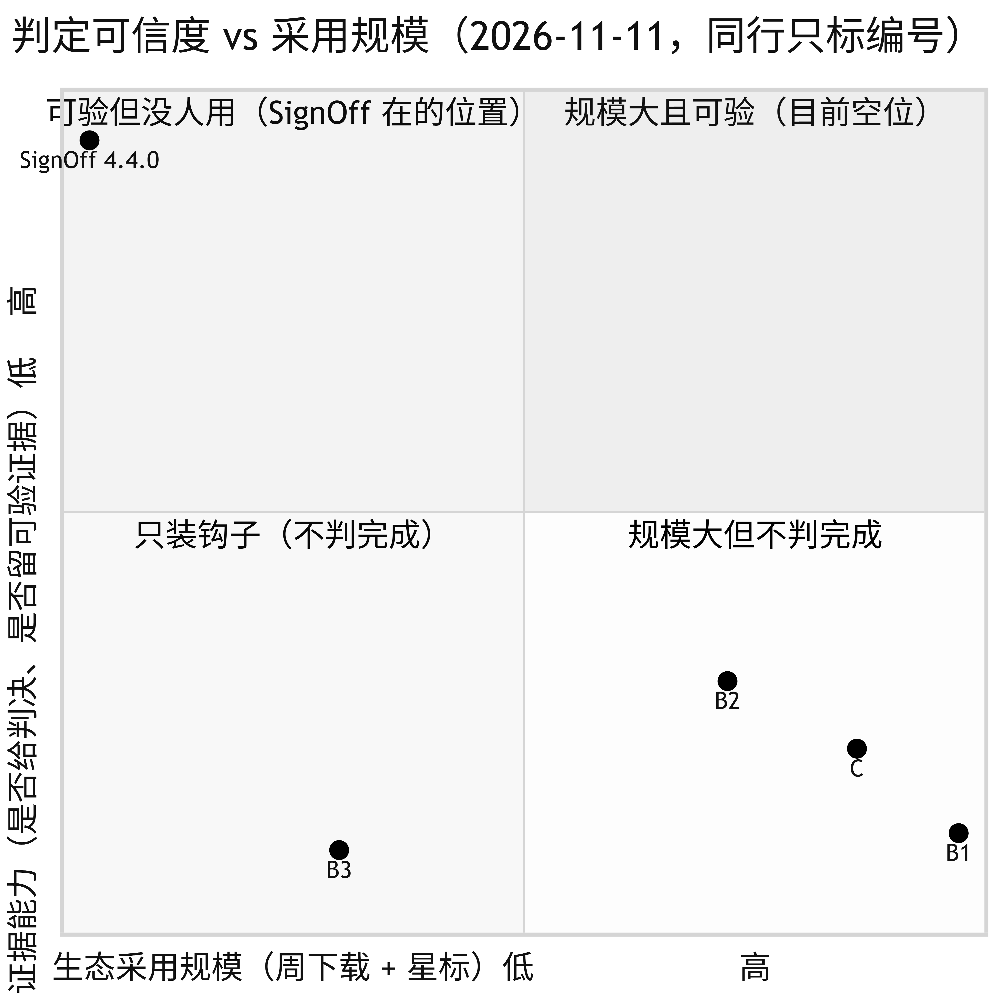
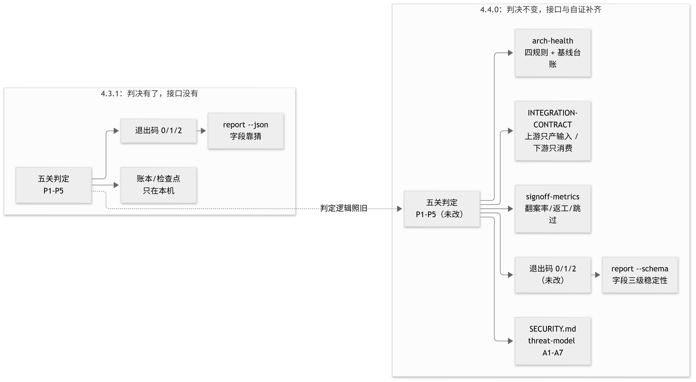

# 与同类工具的对比：位置、象限、打分

> 匿名约定（2026-11-11 起，所有对比一律照此）：同行只按类型标记——A 平台级、B 钩子层（三家分别记 B1/B2/B3）、
> C 密钥扫描、D 文本规则、E 供应链证明、F 覆盖率。本文不点名、不公开对应关系，也不列对方的星标与下载数，
> 需要时说量级。分维度打分是我的判断，依据写在每一行里，不当成第三方评测。

## 1. 先说位置

SignOff 不是 lint、不是格式化、也不是代码审查。它只回答一句：
**这次提交，到底过没过；过了，凭什么。**

所以真正的同类不是"帮你找 bug"的审查层，而是**决定提交能不能进的那一层**：钩子层（B1 / B2 / B3）。
它们和 SignOff 抢同一个位置——`.git/hooks/pre-commit`。

## 2. 采用规模（只说量级）

| 同行 | 给判决 | 留证据 | 采用量 |
| --- | --- | --- | --- |
| B1 | 否（只传退出码） | 否 | 千万级/周以上 |
| B2 | 半（记录跑没跑） | 否 | 千万级/周以上 |
| B3 | 否 | 否 | 千万级/周以上 |
| C | 单关结论 | 只留扫描报告 | 数万 star 级 |
| **SignOff** | **是** | **是** | **数千/周** |

表格里只留能判定的行为与量级：**不写实现语言、不写包名、不写各家精确数字**。
任何一条能反推到具体项目的信息，都等于把匿名标记白做了。

一眼看出的两件事：

1. **规模差四到五个数量级。** 这不是"做得不够好"，是**分发方式**的差距：
   B1 被数万个脚手架的 `package.json` 默认带上，SignOff 需要有人主动装。
2. **SignOff 是这几家里唯一"既判定又留证据"的**，也是最没人用的。这两件事同时成立。

## 3. 六个维度打分（0–5）

打分只看各自文档里能核对的行为，不看宣传语。

| 维度 | B1 | B2 | B3 | C | SignOff |
| --- | --- | --- | --- | --- | --- |
| 判决（是否对"完成"下可机读结论） | 1 | 2 | 1 | 3 | **5** |
| 证据（可事后核验的记录） | 0 | 1 | 0 | 1 | **5** |
| 覆盖（一次覆盖多少种交付失败） | 1 | 2 | 1 | 1 | **5** |
| 门槛（依赖越少越高分） | 5 | 4 | 5 | 5 | 4 |
| agent 适配（MCP / 退出码 / 无交互） | 2 | 3 | 2 | 3 | **5** |
| 规模（采用量，外部数据） | **5** | **5** | 4 | **5** | 1 |
| **合计** | 14 | 17 | 13 | 18 | **25** |

每格的理由：

- **B1**：只负责把钩子装上并调用你的命令。命令退出码非 0 就拦住提交，除此之外不解释、不记账。
  依赖极少、配置一行，所以门槛满分。
- **B2**：多一层"钩子来源 + 版本 + 运行环境"的管理，能跑别人提供的钩子，所以覆盖与门槛都好一档；
  它记录的是"跑没跑"，不记录"这次提交的判定是什么"。
- **B3**：并发执行、启动快。定位与 B1 相同，判定与证据同样为零。
- **C**：单点做得很深（密钥），有自己的规则与基线，所以判决给 3；但它只回答"有没有密钥"。
- **SignOff**：五类失败各有一关，判定即退出码，过闸留 marker + 签名 trailer + 哈希链账本 + 带锚点的检查点。
  门槛扣 1 分：需要 Node 20+ 与一个 git 仓库，装钩子要跑一次 `signoff init`。

## 4. 四象限

横轴是外部采用规模，纵轴是"判决 + 证据"能力。四个象限的名字就是结论：

- **右下（规模大、不判完成）**：B1 / B3 / C。它们做的是"把检查跑起来"，不是"宣布完成"。
- **右上（规模大且可验）**：目前是空的。这不是 SignOff 已经占住的位置，是它**够不到**的位置。
- **左上（可验但没人用）**：SignOff 现在在这里。诚实说，这个象限的产品最容易消失——
  不是因为它错了，是因为没人需要它。
- **左下**：装了钩子但不判任何东西，等于没装。

把这张图放在这里，是为了说明一件事：**SignOff 的问题不在能力，在需求侧还没有人被迫需要它。**
要让象限往右上移动，只有两条路——被别人的默认配置带进去（分发），或者被某个真实场景逼着用（场景）。

## 5. 应用场景与范围

**适合**

| 场景 | 为什么是它 |
| --- | --- |
| agent 参与交付的仓库 | agent 说"做完了"最缺证据；五关正好对应五种常见虚报 |
| 多 agent 并发改同一仓库 | P3 在提交前发现撞文件，不是等 CI 炸 |
| 需要事后回答"那次到底过没过" | 账本 + 检查点 + 锚点，可逐条复验 |
| 发版前的最后一道 | `signoff release --pre` 14 项离线自洽检查 |
| 语言无关的小团队 | 只要 Node 20+ 与 git，不要求 Python/Go/容器 |

**不适合**

| 场景 | 该用什么 |
| --- | --- |
| 非 git 仓库 | 没有钩子，也没有 tree 可签 |
| 想让它"帮着改到绿" | 判定器不该是参与者；用 lint/修复类工具 |
| 需要运行时沙箱（防恶意命令） | 容器/CI 隔离；见 `docs/trust.md` 的"不做什么" |
| 超大 monorepo 的构建编排 | CI 矩阵与缓存；SignOff 只管判定，不管构建 |

## 6. 4.3.1 → 4.4.0 变了什么

| 维度 | 4.3.1 | 4.4.0 |
| --- | --- | --- |
| 下游怎么依赖 | 读 `report --json`，字段靠猜 | `signoff report --schema` 给出三级稳定性 |
| 上下游边界 | 口头 | `docs/INTEGRATION-CONTRACT.md`：上游只产输入、下游只消费输出 |
| 架构自检 | 无 | `arch-health` 四规则 + 基线台账（今日 38/40） |
| 价值度量 | 无 | 翻案率 42.9% / 返工 2.33 轮 / 跳过率 0%（dsh-signoff 样本） |
| 安全披露 | 无 `SECURITY.md` | 明写"未通过第三方审计" + A1–A7 + 9 项就绪清单 |
| 删除纪律 | 无 | D1–D4 |
| 判定逻辑 | — | **未改**（退出码 0/1/2、五关、账本格式均照旧） |

## 7. 诚实的差距

1. **本工具 star 个位数、周下载数千；B1 是数万 star、数千万周下载。** 差四到五个数量级，
   不是一个版本能追的，只能靠"进入别人的默认配置"。
2. **周下载数千**里有多少是 CI 与 npx 重复调用，我没有拆开；真实人数未知。
3. **没有第三方安全审计**（`SECURITY.md` 已明写），也没有外部用户案例。
4. 打分表里"规模"占一维，SignOff 只拿 1 分——**如果按采用量选型，今天就不该选它**。
   它的理由只能是：你需要那个别人不提供的判决与证据。

英文版：[`COMPARISON.en.md`](COMPARISON.en.md)

<!-- EN-BEGIN auto-embedded from docs/COMPARISON.en.md; edit that file and run node tools/sync-bilingual.mjs -->

## English

## How SignOff compares: position, quadrant, scores

> Anonymity rule (in force since 2026-11-11, for every comparison we publish): peers are labelled by category
> only — A platform, B hooks (the three implementations are B1/B2/B3), C secret scan, D prose rules, E supply chain,
> F coverage. No vendor names, no published mapping, no per-peer star or download figures; magnitudes at most.
> The per-dimension scores are my judgement, with the reasoning in each row — not a third-party benchmark.

### 1. Position first

SignOff is not a linter, not a formatter, not a code reviewer. It answers one question:
**did this commit actually pass — and if it did, on what evidence?**

So the real peers are not "find bugs for you" reviewers. They are the layer that decides whether a commit
may enter: the hook layer (B1 / B2 / B3). They compete with SignOff for the same file: `.git/hooks/pre-commit`.

### 2. Adoption size (magnitudes only)

| Peer | Gives a verdict | Keeps evidence | Adoption |
| --- | --- | --- | --- |
| B1 | no (exit code only) | no | tens of millions/week+ |
| B2 | partial (records that it ran) | no | tens of millions/week+ |
| B3 | no | no | tens of millions/week+ |
| C | one-gate result | scan report only | tens of thousands of stars |
| **SignOff** | **yes** | **yes** | **a few thousand/week** |

The table keeps only checkable behaviour and magnitude: **no implementation language, no package names, no exact
per-peer numbers.** Anything that can be traced back to a specific project defeats the anonymous labels.

Two things a reader sees immediately:

1. **Four to five orders of magnitude apart.** Not "built worse" — a **distribution** gap:
   B1 ships inside the `package.json` of tens of thousands of scaffolds; SignOff has to be installed on purpose.
2. **SignOff is the only one here that both decides and keeps evidence — and it is the least used.** Both are true.

### 3. Six dimensions (0–5)

Scored on behaviour that can be checked in each project's own documentation, not on marketing copy.

| Dimension | B1 | B2 | B3 | C | SignOff |
| --- | --- | --- | --- | --- | --- |
| Verdict (machine-readable conclusion about "done") | 1 | 2 | 1 | 3 | **5** |
| Evidence (records you can re-check later) | 0 | 1 | 0 | 1 | **5** |
| Coverage (how many delivery failures one run covers) | 1 | 2 | 1 | 1 | **5** |
| Footprint (fewer dependencies scores higher) | 5 | 4 | 5 | 5 | 4 |
| Agent fit (MCP / exit code / no interaction) | 2 | 3 | 2 | 3 | **5** |
| Scale (adoption, external data) | **5** | **5** | 4 | **5** | 1 |
| **Total** | 14 | 17 | 13 | 18 | **25** |

Why each cell:

- **B1**: installs the hook and calls your command. A non-zero exit blocks the commit; beyond that it neither
  explains nor records anything. Almost no dependencies, one line of config — hence the full footprint score.
- **B2**: adds a layer of "hook source + version + runtime" management and can run hooks supplied by others, so
  coverage and footprint are a notch better. It records *that* it ran, not what the verdict for this commit was.
- **B3**: parallel execution, fast start. Same position as B1, and the same zero for verdict and evidence.
- **C**: deep in one place (secrets), with its own rules and baselines, so the verdict score is 3 — but it answers
  only "is there a secret".
- **SignOff**: one gate per class of failure, the verdict is the exit code, and a pass leaves a marker + a signed
  trailer + a hash-chained ledger + an anchored checkpoint. Loses one footprint point: needs Node 20+ and a git
  repo, and installing the hook takes one `signoff init`.

### 4. Four quadrants

The horizontal axis is external adoption, the vertical axis is "verdict + evidence". The quadrant names are the
conclusion:

- **Bottom right (large, decides nothing)**: B1 / B3 / C. They make checks run; they do not declare completion.
- **Top right (large and verifiable)**: empty today. That is not a position SignOff holds — it is one it cannot reach.
- **Top left (verifiable, nobody uses it)**: SignOff sits here now. Honestly, products in this quadrant disappear
  most easily — not because they are wrong, but because nobody needs them yet.
- **Bottom left**: a hook installed that decides nothing, which is the same as no hook.

The point of the picture: **SignOff's problem is not capability, it is that demand has not caught up.**
Moving right means either being carried by someone else's defaults (distribution) or being forced by a real
situation (scenario).

### 5. Where it fits

**Fits**

| Situation | Why this |
| --- | --- |
| Repos where agents deliver code | "I'm done" is the claim with the least evidence; the five gates map to the five usual overclaims |
| Several agents editing one repo | P3 catches colliding files before the commit, not after CI breaks |
| Answering "did that one pass?" months later | ledger + checkpoint + anchor, re-checkable entry by entry |
| Last step before a release | `signoff release --pre` runs 14 offline consistency checks |
| Small language-agnostic teams | Node 20+ and git only; no Python/Go/container requirement |

**Does not fit**

| Situation | Use instead |
| --- | --- |
| Not a git repository | no hook, and no tree to sign |
| "Fix it until it is green" | a verdict tool should not be a participant; use a linter/fixer |
| Runtime sandboxing against hostile commands | container/CI isolation; see the "what we do not do" list in `docs/trust.md` |
| Build orchestration for a huge monorepo | CI matrices and caching; SignOff only decides, it does not build |

### 6. What changed from 4.3.1 to 4.4.0

| Dimension | 4.3.1 | 4.4.0 |
| --- | --- | --- |
| How downstream depends on it | read `report --json`, guess the fields | `signoff report --schema` states three levels of stability |
| Upstream/downstream boundary | verbal | `docs/INTEGRATION-CONTRACT.md`: upstream only produces inputs, downstream only consumes outputs |
| Architecture self-check | none | `arch-health` with four rules + a baseline ledger (38/40 today) |
| Value measurement | none | reversal rate 42.9% / rework 2.33 rounds / skip rate 0% (dsh-signoff sample) |
| Security disclosure | no `SECURITY.md` | states "not third-party audited" + A1–A7 + a 9-item readiness list |
| Deletion discipline | none | D1–D4 |
| Verdict logic | — | **unchanged** (exit codes 0/1/2, five gates, ledger format all as before) |

### 7. The honest gaps

1. **This tool: single-digit stars, a few thousand weekly downloads. B1: tens of thousands of stars, tens of
   millions of weekly downloads.** Four to five orders of magnitude — not something one release closes; it takes
   getting into other people's default configuration.
2. Of those few thousand weekly downloads, how many are CI and npx repeats is unknown to me; the real user count is not.
3. **No third-party security audit** (`SECURITY.md` says so) and no external user case studies.
4. "Scale" is one of the six dimensions and SignOff scores 1 on it — **if you choose by adoption, today is not the
   day to pick it.** The only reason is that you need the verdict and evidence nobody else provides.

Chinese original: [`COMPARISON.md`](COMPARISON.md)

<!-- EN-END -->
